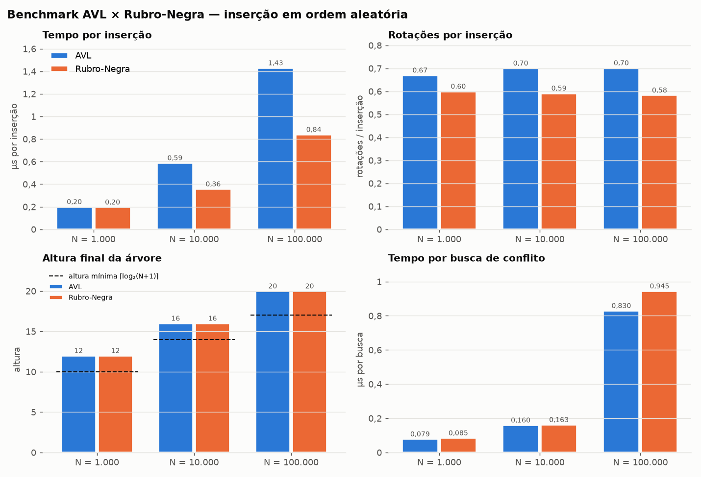

# Sistema de Reservas com Detecção de Conflito — AVL × Rubro-Negra

**EDA2 2026.2 · Trabalho 3 (Árvores)  GRUPO: 22 · Prof. Maurício Serrano**
Dupla: **Anna Clara** e **Esdras**

Software de linha de comando que gerencia reservas de recursos compartilhados
(salas, laboratórios, quadras). Ao receber um pedido `[início, fim)` ele diz na
hora se há conflito com uma reserva existente, mostra qual é e sugere o próximo
horário livre. Também lista a agenda de um período e carrega ou salva reservas em CSV.

As reservas de cada recurso ficam numa **árvore balanceada ordenada pelo
início**. A mesma interface (`agenda.h`) tem duas implementações, **AVL** e
**Rubro-Negra**, e por isso as duas podem ser comparadas lado a lado.

## Compilar e rodar

Requer `gcc` e `make` (no Windows: MinGW, usando `mingw32-make` no lugar de `make`).
O gráfico do benchmark precisa de Python 3 com `matplotlib`.

```sh
make              # compila reservas, gerador e benchmark
make test         # roda os 5 conjuntos de testes
make run          # abre a CLI já com data/exemplo.csv
make demo         # roda o roteiro data/demo.txt com AVL e com Rubro-Negra
make bench        # benchmark (resultados.csv) + gráfico (resultados/benchmark.png)
make clean
```

Tudo compila com `-Wall -Wextra -std=c11` sem avisos.

## Uso da CLI

```
reservas [-a avl|rb] [-e] [arquivo.csv]
```

`-a` escolhe a árvore (padrão: AVL). `-e` ecoa cada comando lido, o que é útil
para rodar um roteiro com `reservas -e < data/demo.txt`.

| comando | o que faz |
|---|---|
| `reservar <recurso> <data> <inicio> <fim\|+min> [responsável]` | cria a reserva; em conflito mostra a reserva conflitante e sugere o próximo horário livre com a mesma duração |
| `cancelar <id>` | cancela a reserva |
| `conflito <recurso> <data> <inicio> <fim\|+min>` | só verifica, sem reservar |
| `listar <recurso\|*> <data> [data_final]` | agenda do(s) dia(s) em ordem (percurso em ordem da árvore) |
| `livre <recurso> <data> <hora> <duração_min>` | próximo horário livre a partir de data/hora |
| `recursos` | recursos com quantidade de reservas, altura e rotações da árvore |
| `carregar <arq.csv>` / `salvar <arq.csv>` | importa ou exporta reservas |

Datas `AAAA-MM-DD`, horas `HH:MM`. Use `+minutos` no fim para atravessar a
meia-noite e aspas para nomes com espaço.

```
> reservar Sala1 2026-11-16 09:30 10:30 "Anna Clara"
  CONFLITO com a reserva:
  #8     Sala1          2026-11-16 10:00 -> 11:00            Esdras
  sugestao: proximo horario livre com a mesma duracao: 2026-11-16 11:00 -> 2026-11-16 12:00
```

Os intervalos são **semiabertos**: `[10:00, 11:00)` não conflita com
`[11:00, 12:00)`. Conflito só existe entre reservas do **mesmo recurso**.

### Formato do CSV

```
id,recurso,inicio,fim,responsavel
1,Sala1,2026-11-16 08:00,2026-11-16 09:30,Anna Clara
```

- O separador é detectado sozinho (`,` `;` ou TAB) e as colunas são achadas pelo
  nome, em qualquer ordem. `id` e `responsavel` são opcionais: sem id, o sistema
  gera um.
- Aceita campos entre aspas, BOM do Excel e finais de linha CRLF.
- **Cada linha inválida é relatada com o número da linha e o motivo, e a carga
  continua**: data inexistente, fim ≤ início, id repetido, campos faltando ou
  conflito com uma reserva já carregada. Veja `carregar data/exemplo_com_erros.csv`.

### Gerador de reservas

```sh
gerador -n 100000 -r 4 -o data/grande.csv   # 100 mil reservas em Sala1..Sala4
```

Gera reservas **sem sobreposição por construção**: dias úteis das 08:00 às
20:00, duração de 30 min a 2 h. A ordem pode ser embaralhada (padrão) ou
cronológica (`--ordenado`).

## Estrutura

```
src/
  agenda.h, agenda_impl.h, agenda.c   interface comum + despachante      (Anna)
  agenda_avl.c, agenda_rb.c           árvores AVL e Rubro-Negra          (Anna)
  reserva.h/.c                        modelo, data/hora <-> minutos       (Esdras)
  sistema.h/.c                        uma agenda por recurso + mapa id    (Esdras)
  csv.h/.c                            leitura/gravação com validação      (Esdras)
  gerador.h/.c, gerador_main.c        gerador de reservas                 (Esdras)
  main.c                              CLI 'reservas'                      (Esdras)
tools/benchmark.c                     benchmark AVL x RB                  (Anna)
scripts/graficos.py                   gráfico do benchmark                (Esdras)
tests/  test_avl.c, test_rb.c, test_agenda.c (Anna) · test_reserva.c, test_csv.c (Esdras)
data/   exemplo.csv, exemplo_com_erros.csv, demo.txt
resultados.csv, resultados/benchmark.png
```

**Por que um `Sistema` acima da `Agenda`?** Cada árvore guarda um único recurso
e não conhece ids. O `Sistema` mantém uma agenda por recurso e uma tabela hash
`id → recurso` (endereçamento aberto). Com ela os ids ficam únicos no sistema
inteiro e o cancelamento vai direto para a agenda certa.

## Benchmark AVL × Rubro-Negra

**Metodologia** (`tools/benchmark.c`). Para N = 1.000, 10.000 e 100.000, as duas
árvores recebem exatamente a mesma carga, através da interface `agenda.h`:

1. **Inserção:** N reservas sem sobreposição, inseridas em ordem aleatória.
   Mede tempo, altura final e total de rotações.
2. **Consulta:** com a agenda pronta, 200.000 buscas de conflito com intervalos
   aleatórios.

Cada medição se repete até somar ~50 ms, e o resultado é a média das
repetições. Os números abaixo vêm da semente 42 (`resultados.csv`). Rodamos
também as sementes 7 e 2026 para conferir se as conclusões se repetem.

**Correção no gerador de números aleatórios.** A primeira versão usava
`rand()`, que no Windows só vai até 32767. Com isso, todas as consultas caíam
nos primeiros ~0,3% da agenda: para N = 100.000 o tempo de consulta saía cerca
de 7× menor e nem crescia com N. O benchmark agora usa um gerador de 32 bits
próprio (xorshift32).



| N | inserção AVL (ms) | inserção RB (ms) | altura AVL | altura RB | rotações AVL | rotações RB | consulta AVL (ms) | consulta RB (ms) |
|---:|---:|---:|---:|---:|---:|---:|---:|---:|
| 1.000 | 0,13 | 0,10 | 12 | 12 | 670 | 600 | 13,3 | 10,7 |
| 10.000 | 2,58 | 2,00 | 16 | 16 | 7.008 | 5.917 | 30,1 | 33,0 |
| 100.000 | 87,1 | 54,6 | 20 | 20 | 70.176 | 58.330 | 120,0 | 142,9 |

*(tempos de consulta para 200.000 buscas)*

### Análise

**Inserção: a Rubro-Negra é mais rápida.** Ela faz **16–17% menos rotações**
(≈0,58 contra ≈0,70 por inserção, nas três sementes). Em tempo, foi de 14% a
48% mais rápida, conforme o N e a semente. O ganho vem de duas fontes:

- **Rotações:** na Rubro-Negra, o rebalanceamento após uma inserção faz no máximo
  2 rotações, e na maioria dos casos só recolore nós.
- **Altura:** a inserção da AVL é recursiva e, na volta, recalcula a altura de
  todos os nós do caminho. A da Rubro-Negra é iterativa e para assim que o
  problema de cor é resolvido.

**Altura: empate na prática.** Com inserções em ordem aleatória as duas ficaram
com a mesma altura: 12, 16 e 20, poucos níveis acima do mínimo ⌈log₂(N+1)⌉.
Na teoria, a AVL garante altura ≤ 1,44·log₂N e a Rubro-Negra ≤ 2·log₂N. Essa
diferença só aparece em entradas desfavoráveis. Em um teste à parte, inserindo
as reservas **em ordem cronológica** (o caso real, já que as reservas chegam
por data), a AVL ficou com altura 18 para 200 mil reservas e a Rubro-Negra
com 33.

**Consulta: sem vencedor claro.** A busca de conflito desce um único caminho da
raiz até uma folha. Com alturas iguais, o custo é praticamente o mesmo. As
diferenças medidas mudam de lado entre as sementes (numa delas, para N = 10.000,
a AVL saiu 40% mais rápida; em outra, a Rubro-Negra saiu 20% mais rápida para
N = 1.000), então são ruído de medida (cache, escalonamento do sistema), não uma vantagem estrutural. O
tempo cresce com N porque a árvore deixa de caber no cache do processador.

**Qual usar na agenda?**
- Se as reservas são **mais consultadas do que criadas**, as duas servem.
- Se há **muitas criações e cancelamentos**, a Rubro-Negra é a melhor escolha:
  insere mais rápido e com menos rotações.
- Se os dados chegam **ordenados**, a AVL mantém a árvore mais baixa, o que
  protege o pior caso das buscas.

Em todos os casos, as duas garantem O(log n) para inserir, detectar conflito e
achar o próximo horário livre. Com uma lista ou um vetor ordenado, inserir e
remover custariam O(n).


## Testes

`make test` roda:

- `test_avl` / `test_rb`: 3.000 inserções aleatórias conferidas contra um
  modelo-sombra, conflito, listagem, próximo livre, cancelamento e limite de altura.
- `test_agenda`: a mesma bateria nas duas árvores pela interface e a
  verificação cruzada (as duas precisam dar respostas idênticas).
- `test_reserva`: conversão data/hora (bissextos, virada de ano, datas
  inválidas) e validação do modelo.
- `test_csv`: divisão de campos com aspas, `Sistema` com vários recursos e ids,
  carga com 7 tipos de linha inválida e o ciclo salvar → recarregar.